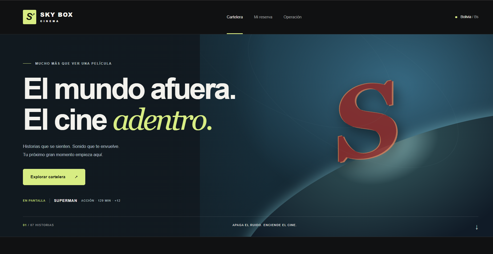

# Sky Box Cinema — V4 Web



## Sobre esta versión

Sky Box V4 es una evolución personal e independiente desarrollada por Alejandro Rivera.

Aunque el proyecto original de consola nació como un trabajo universitario grupal, esta nueva versión web fue desarrollada por iniciativa propia y no forma parte de una asignatura, entrega ni proyecto institucional de la universidad.

La autoría y los créditos de la versión universitaria original se conservan en su documentación e historial. Esta distinción corresponde al desarrollo de la versión V4.

## Funcionalidades

- Cartelera con filtros por película, fecha y sala.
- Selección de asientos y reservas de grupos.
- Consulta y cancelación de reservas.
- Comprobante imprimible.
- Panel de operación con programación y ocupación.
- Diseño oscuro adaptable a dispositivos móviles.

## Tecnologías

C#, .NET 10, ASP.NET Core Razor Pages, HTML, CSS y JavaScript.

Actualmente, los datos se almacenan en memoria y se reinician al detener el servidor. La persistencia con SQLite está prevista para una siguiente fase.

## Ejecución local

```powershell
dotnet run --project src/SkyBox.Web
```

Abrir http://localhost:5080.

## Documentación

- [Guía de uso](docs/V4-USER-GUIDE.md)
- [Validación funcional](docs/V4-FUNCTIONAL-VALIDATION.md)

## Versión original de consola

El código original se conserva en la carpeta `progam`. Sus créditos universitarios corresponden a esa versión.